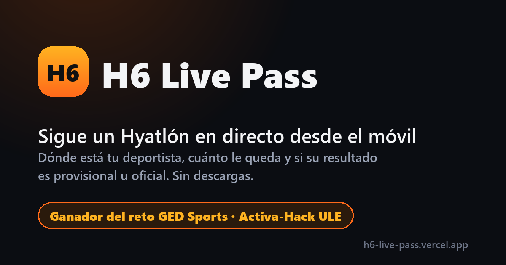

[English](README.md) | **Español**

# H6 Live Pass



Una web móvil, sin descargas, para que quien va por primera vez a un Hyatlón H6 entienda la competición y siga a su deportista en directo. **Ganadora del reto de GED Sports en ActivaHack 2026 (Universidad de León).**

- **Pruébala en el móvil:** https://h6-live-pass.vercel.app
- **Vista para presentar (PC):** https://h6-live-pass.vercel.app/presentar

## El problema
Un Hyatlón H6 alterna 6 tramos de 1 km de carrera con 6 estaciones de fuerza. En cada sede compiten cerca de 1.000 atletas y sale una tanda cada 15 minutos, así que hay gente en fases muy distintas a la vez. Hoy los resultados se publican al terminar, en un PDF por categoría, sin parciales ni seguimiento en directo. Desde la grada cuesta saber dónde está tu deportista, qué está haciendo o si su puesto es definitivo.

## Qué hace la app
- **Encontrar a tu deportista** por nombre, dorsal o tanda, y seguirle con un toque.
- **Estado en directo:** en qué estación o tramo está, cuánto lleva, cuánto le falta para la siguiente estación y para meta, y avisos en cada alfombra de chip.
- **Entender la prueba:** introducción de un minuto, guía de cada estación con animaciones y pesos por categoría, y el cronograma de tandas en directo.
- **Provisional u oficial:** cada puesto indica su estado (provisional, en revisión u oficial) y quién le ha superado desde una tanda posterior.
- **Compartirlo:** una imagen del resultado al estilo Strava para Instagram o WhatsApp, también como sticker sin fondo.

## Cómo funciona
- **Sin servidor.** Toda la jornada se genera en el navegador con una simulación determinista con semilla, así que cada dispositivo calcula exactamente la misma carrera.
- **Los móviles se sincronizan con el QR.** El QR de la vista de PC lleva el reloj de la carrera (hora, referencia, velocidad y pausa). Cada móvil que lo escanea ve el mismo momento de la carrera, sin ningún servidor de por medio.
- **Datos confirmados y estimados.** Lo que viene de una alfombra de chip se marca con ✓. Lo que pasa entre dos alfombras se estima con el ritmo del propio atleta y siempre se marca con ~.
- **Basado en el formato real.** Las estaciones, categorías, pesos y tandas salen de documentos oficiales de Hyatlón y la FETRI. Lo que todavía no es público (dónde están exactamente las alfombras, el plazo de revisión) se trata como supuesto. Más detalle en [`investigacion/RESUMEN.md`](investigacion/RESUMEN.md).
- **HTML, CSS y JavaScript sin más.** Sin frameworks ni compilación. Vercel sirve la carpeta `web/` como sitio estático.

## Estructura
| Ruta | Para qué |
|---|---|
| `web/index.html` | La app del espectador (móvil): Seguir, Clasificación, Tandas y Guía. `m.html` redirige aquí para los QR antiguos |
| `web/presentar.html` | Vista para el PC o el proyector: escenarios de la historia, reloj de la carrera, el móvil incrustado y el QR |
| `web/js/data.js` | Motor de simulación: categorías, tandas, alfombras de chip y clasificaciones |
| `web/js/scenarios.js` | Los 8 momentos de la historia de la demo |
| `web/js/talk.js` | Demo guiada de 3 minutos |
| `web/anim/` | Animaciones SVG de cada estación |
| `investigacion/` | Qué es oficial, qué es supuesto y qué se ha descartado |

## Presentar (3 minutos)
Pulsa **▶ Presentar** (o la tecla `P`) en la vista de PC:

1. **El problema**: pantalla fija. Pasa a la siguiente con `→`.
2. **Demo guiada** (unos 115 s): 8 pasos automáticos, con subtítulos y resaltado en el móvil. El último muestra la foto para redes y el sticker. Para usar una foto real, elígela antes en «Foto del paso 8»: se guarda solo en el navegador de ese portátil y no se sube a ningún sitio. `espacio` la pausa, `←` y `→` mueven entre pasos.
3. **¿Es viable?**: datos, recursos y coste (cifras estimadas) y la prueba piloto.
4. **Resumen** con el QR para que el jurado lo pruebe.

`Esc` sale del modo Presentar.

## Exploración libre
- Abre la vista de PC (`/presentar`).
  - `←` y `→` pasan de un escenario a otro.
  - `espacio` pausa el reloj.
  - Los botones ×10 y ×60 aceleran la carrera.
  - `F` pone la pantalla completa y `R` abre el resumen final, con el QR.
- El jurado escanea el QR y explora la app en su móvil.
- Quien abre la app desde el QR va sincronizado con el PC y no ve el botón Demo. Si abres la app directamente, el botón **⚙︎ Demo** (también al final de la Guía) permite mover el reloj o saltar a un escenario.

## Probar en local
```bash
python -m http.server 5173 --bind 0.0.0.0 --directory web
```

Abre `http://localhost:5173/` para la app y `http://localhost:5173/presentar.html` para la vista de PC. Para probarlo en el móvil con la wifi, abre `http://<IP-del-PC>:5173/` y escribe esa misma dirección en «¿El QR apunta a localhost?».

## Publicar
Vercel publica la carpeta `web/` como sitio estático (ver `vercel.json`) en cada push a `main`. Para hacerlo a mano:

```bash
npx vercel deploy web --prod
```

## Equipo
- **Iván Rodríguez Steuerberg** · [LinkedIn](https://www.linkedin.com/in/ivansteuerberg/)
- **Álvaro Rodríguez Pino** · [LinkedIn](https://www.linkedin.com/in/alvarorodriguezpino/)

Los atletas y resultados de la demo son ficticios.

## Licencia
© 2026 Iván Rodríguez Steuerberg y Álvaro Rodríguez Pino. Todos los derechos reservados. El código es público para que se pueda revisar; no se puede copiar, modificar ni redistribuir sin permiso.
